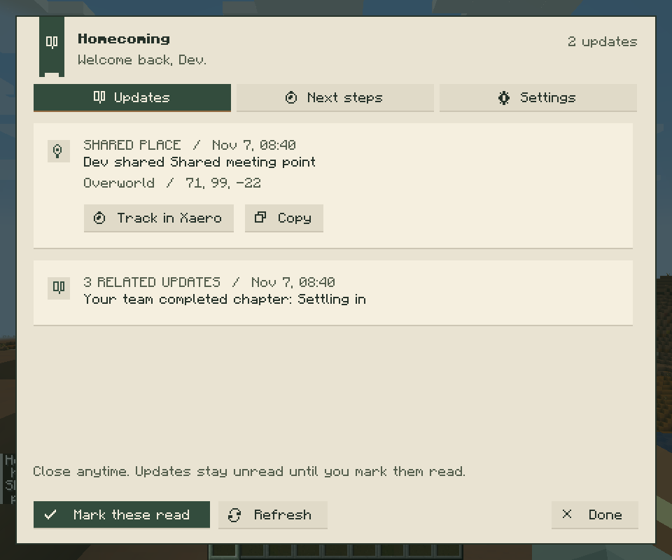

# Homecoming

A catch-up companion for Minecraft **1.21.1 / NeoForge 21.1**. Return to your friends' world, see what changed, and find an existing quest you can pick up.

Homecoming reuses FTB Quests and FTB Teams instead of asking everyone to maintain another quest book. It works without an AI service.

**Download:** [0.2.0-alpha.2 prerelease](https://github.com/Cookie-Cat21/homecoming/releases/tag/v0.2.0-alpha.2), including the JAR, SHA256 checksum, installation instructions and known limits. Connected-player feedback and full-pack gameplay validation remain open. Use the [friend-group pilot guide](docs/friend-group-pilot.md) for testing.

## Early implementation

- Team quest and chapter completion briefings.
- Selected vanilla progression milestones.
- Shared locations with dimension and copyable coordinates.
- Up to two currently available visible quests.
- Opt-in participation and explicit read acknowledgment.
- History stored with the world, bounded to 30 days / 2,000 updates.

**Status:** 0.2.0-alpha.2 is in development with a native journal screen, authenticated client/server actions, configurable history, quest grouping, membership periods and a version-pinned Xaero adapter. Eleven model tests pass. A dedicated NeoForge server loaded the pinned FTB mods and verified SavedData persistence across two JVM runs. Live quest-event, map and full-pack validation is still in progress; see the [delivery checklist](docs/implementation-status.md).

## In-game journal

Actual in-game journal, captured in the disposable test world on Minecraft 1.21.1 / NeoForge:



The [Settings screenshot](docs/ui/screenshots/homecoming-settings.png) shows return-prompt controls and active integration status.

See the [complete UI/engineering flowcharts](docs/ui/ui-flows.md), [design specification](docs/ui/interface-design.md), [Next steps capture](docs/ui/screenshots/homecoming-next-steps.png), and [read-only world rules](docs/ui/screenshots/homecoming-world-rules.png). Screenshots use sample quests in a disposable test world.

## Build

Install a Java 21 JDK, then:

```sh
cd homecoming
./gradlew build --no-daemon --max-workers=2
```

On Windows, use `gradlew.bat`. The JAR is written to `homecoming/build/libs/`.

See the [mod README](homecoming/README.md) for commands, integration versions, installation and the first two-player test.

## Project material

- [Source and tests](homecoming/src)
- [Scope and integration plan](homecoming-scope.md)
- [Opportunity research and evidence](minecraft-opportunity-research-2026-11-06.md)
- [Interactive UI concept source](docs/ui/homecoming-ui.fragment.html)

The UI concept is a conversation-rendered HTML fragment with proposed interactions; it is not the current Minecraft screen. Research records public-source observations and uncertainty, not an exhaustive market survey.

## Licensing and attribution

Homecoming's original code is currently **All Rights Reserved**, pending a license choice. Public availability does not grant an open-source license. The NeoForge MDK template retains its [MIT notice](homecoming/TEMPLATE_LICENSE.txt). Optional integrations are referenced and are not bundled.
