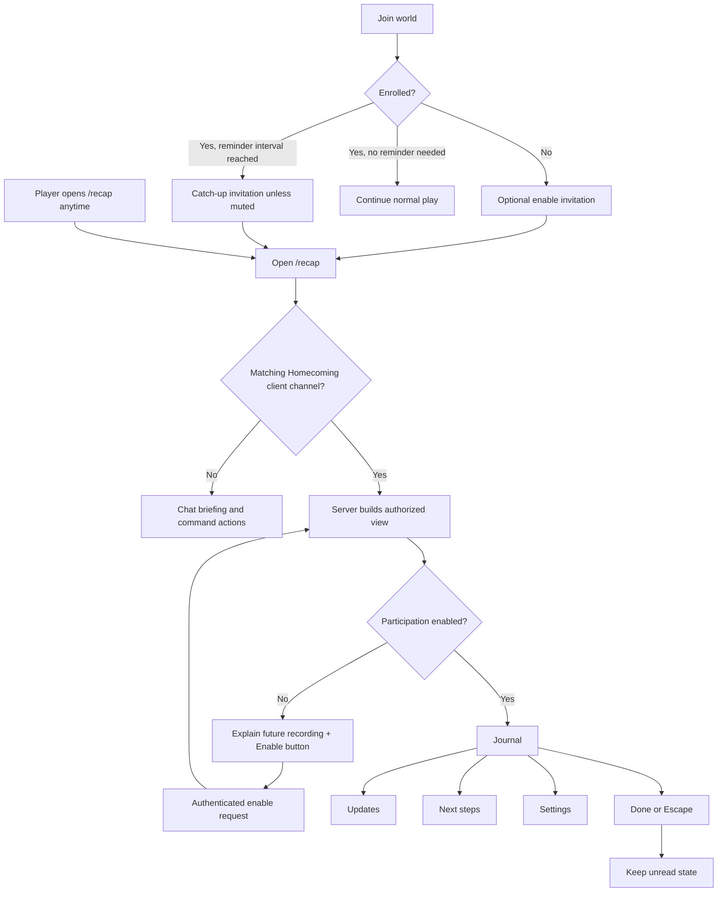
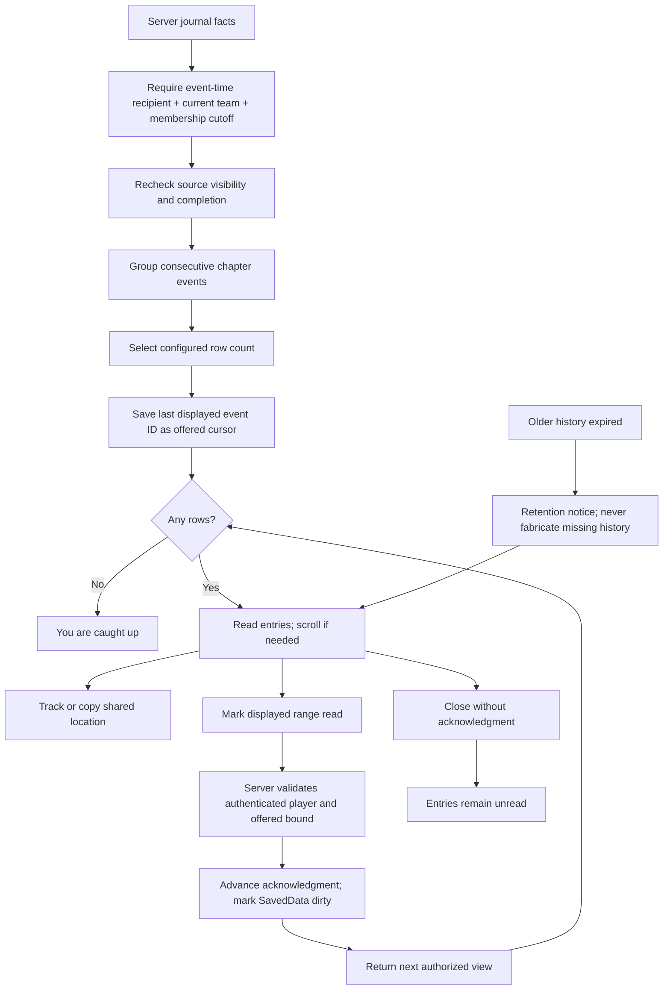
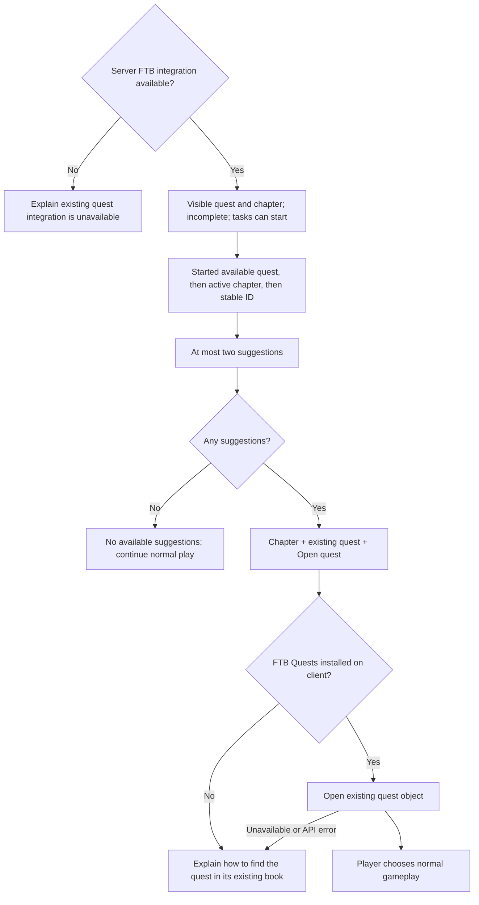
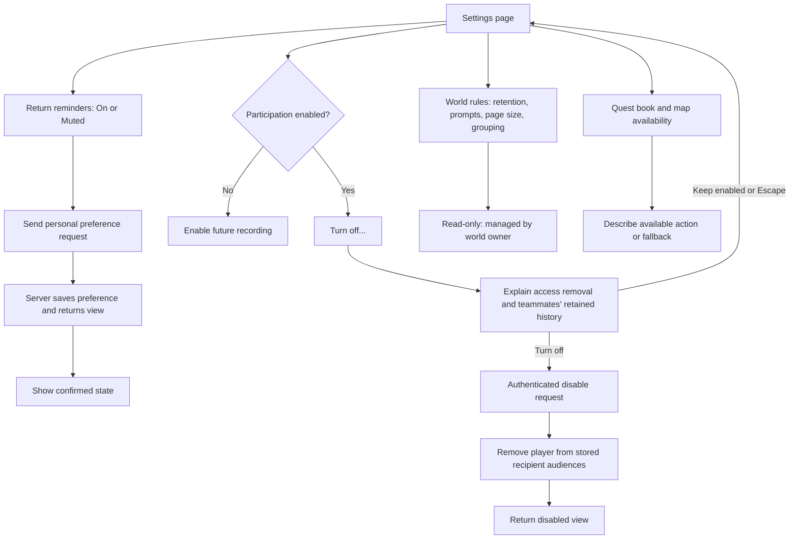
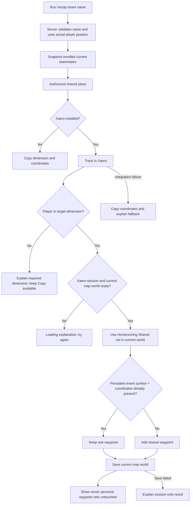
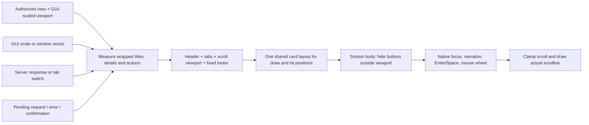

# Homecoming UI and engineering flows

These diagrams cover the implemented journal and its recovery paths. Personal settings belong to the player; world rules belong to the server. The mod never completes quests or claims rewards through this interface.

## 1. Entry, enrollment and navigation



## 2. Updates, pages and acknowledgment



## 3. Next steps and quest navigation



## 4. Settings, consent and authority



## 5. Location and map safety



## 6. Client/server request lifecycle and recovery

```mermaid
sequenceDiagram
    actor Player
    participant UI as Journal screen
    participant Net as Optional versioned payload channel
    participant Server as Server main thread
    participant Store as World SavedData
    Player->>UI: Enable / mute / mark read / disable / refresh
    UI->>UI: Pending feedback; block repeat mutation
    UI->>Net: Whitelisted action + offered event ID
    Net->>Server: Authenticated connection's player
    Server->>Server: Rate limit and action validation
    Server->>Store: Apply permitted player-specific mutation
    Store-->>Server: Current authoritative state
    Server->>Server: Reapply membership, visibility and page selection
    alt Response arrives
        Server-->>Net: Authorized view + read-only world rules
        Net-->>UI: Schedule on client main thread
        UI->>UI: Rebuild measured content; clear pending; confirm result
    else No response before timeout
        UI->>UI: Restore controls; explain retry
    end
```

## 7. Rendering and input layout



## State and acceptance matrix

| State | User sees | Required behavior |
| --- | --- | --- |
| Not enrolled | Recording explanation and Enable | No retroactive import; server enrolls only this player |
| No unread entries | Caught-up entry | No mark-read action |
| Populated updates | Time, readable event, location action where relevant | Only authorized rows; close preserves unread state |
| Long title/history | Wrapped text, scroll thumb | Every action remains reachable at small GUI sizes |
| Suggestions unavailable | Clear empty/integration explanation | No invented quest or progression change |
| Pending mutation | Saving/refreshing status | No repeated mutation until reply or timeout |
| No reply | Retry explanation | Controls recover; no false saved message |
| Disable confirmation | Effect and explicit choices | Cancel preserves participation; confirm changes server state |
| Missing map/quest client mod | Copy/find-in-book fallback | Journal stays usable |
| Wrong dimension | Required dimension explanation | No waypoint added to wrong map |
| World rules | Actual server values, read-only label | Client cannot edit server policy |
| Keyboard or GUI resize | Visible focus and recomputed layout | No clipped reachable hit targets or icon-only mystery controls |
